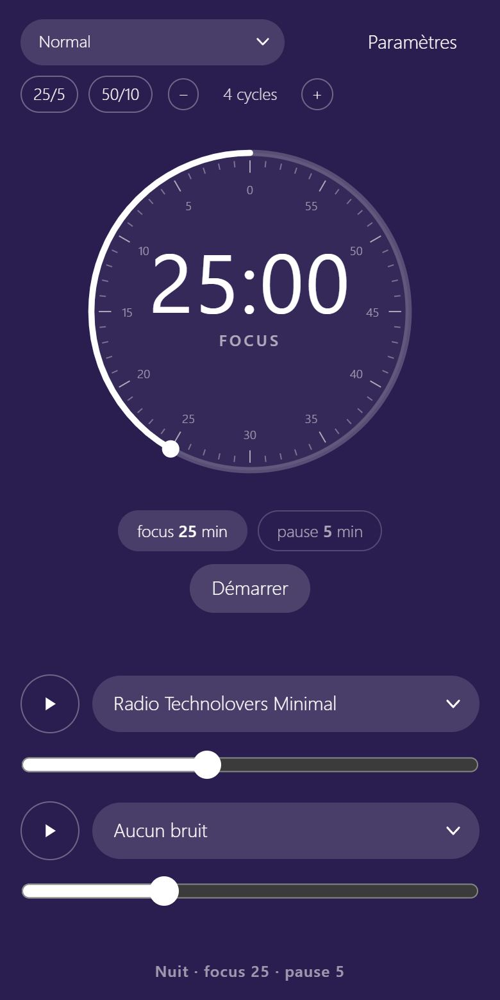
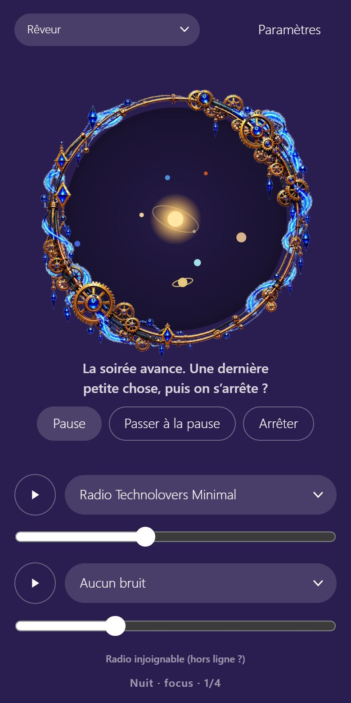
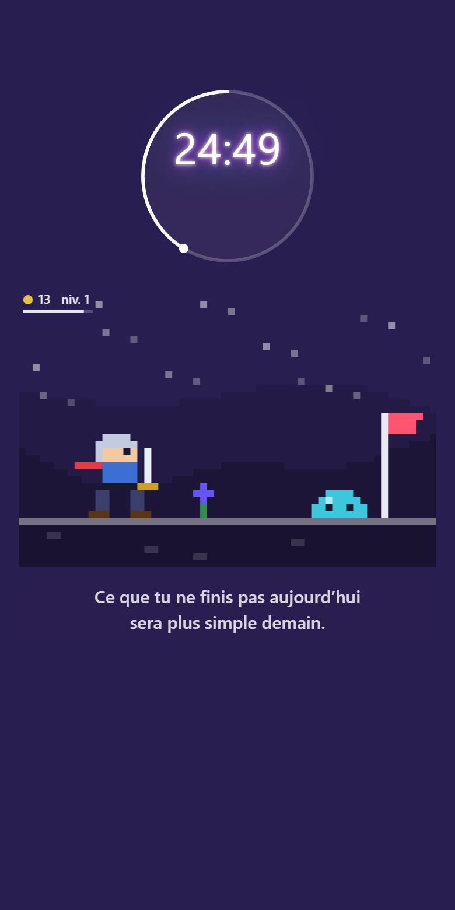
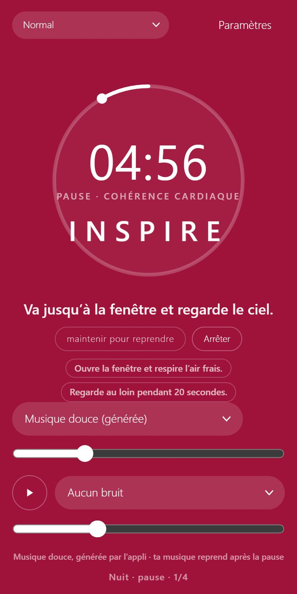

# projetfocus

Un minuteur pour rythmer tes journées de travail : un temps de focus, puis une vraie pause.
Un seul écran : le fond suit l'heure de la journée, un cadran qu'on tourne comme un minuteur de
cuisine, le temps au centre. Radio, bruits de fond et mini-jeu en option.

**Site : https://darkcapp68-web.github.io/projetfocus/** (à installer depuis Chrome, voir plus bas)

| Réglage | Style « Rêveur » | Mode Rythme · Petit héros | Pause |
| --- | --- | --- | --- |
|  |  |  |  |

PWA en HTML, CSS et JavaScript, sans framework ni étape de build : le dossier se publie tel quel.
Les décisions de conception sont dans [REGLES.md](REGLES.md), l'état d'avancement dans
[CHANTIER.md](CHANTIER.md), le besoin d'origine dans [CAHIER_DES_CHARGES.md](CAHIER_DES_CHARGES.md).

---

## Ce que fait l'appli

- **Focus et pause.** Tourne le cadran (1 à 60 min), touche « focus » ou « pause » sous le cadran
  pour régler l'un ou l'autre, préréglages 25/5 et 50/10, nombre de cycles, pause longue.
- **Un fond qui suit l'heure.** Six moments (nuit, aube, matinée, midi, après-midi, soirée), la
  couleur glisse en continu minute par minute. Tout est réglable.
- **Une vraie pause.** Écran d'une couleur tirée au hasard, respiration guidée (cohérence
  cardiaque 5/5 par défaut, ou apaisante, carrée, 4-7-8), une action du coach, « maintenir pour
  reprendre », compte à rebours en tic-tac, 3 « ding » puis reprise automatique du focus.
- **Messages bienveillants** pendant le focus, notifications, plein écran en option.
- **Son.** Radios sans pub (techno / ambient, classique), playlists libres de droits gardées hors
  ligne, bruits générés (pluie, orage, vent, neige, café), musique douce de pause.
- **Quatre manières d'afficher le cadran**, au choix dans le menu « Affichage » en haut à gauche :
  - **Normal** : l'arc blanc, qui s'efface doucement pendant le focus ;
  - **Rêveur** : un cadre en engrenages, un système solaire en focus, une vague en pause ;
  - **Rythme** : le cadran bat avec la musique, affiche le BPM, et dessine des formes néon
    (barres, onde, goutte, sonar, étincelles, anneaux et jauge arc-en-ciel, onde horizontale) ;
  - **Petit héros**, façon jeu idle : un chevalier en pixels court sans s'arrêter au rythme de la
    musique, ramasse des pièces, bat des slimes, ouvre des coffres, gagne des niveaux, avance
    vers un drapeau pendant le focus et dort près d'un feu de camp pendant la pause.
- **Téléphone en paysage** : l'horloge à gauche, la barre du temps, le message et les boutons à
  droite.
- **Paramètres** en 6 sections repliables (Temps, Pause, Musiques et sons, Messages, Apparence,
  Sauvegarde), export / import JSON, sauvegarde de tes réglages sur ton Google Drive.

Raccourcis clavier : `Espace` démarre ou met en pause, les flèches règlent le cadran, `Échap`
ferme les Paramètres.

---

## Installer l'appli

Ouvre `https://darkcapp68-web.github.io/projetfocus/` puis :

- **Téléphone ou tablette Android (Chrome)** : menu `⋮` → *Ajouter à l'écran d'accueil* →
  *Installer*. L'appli a son icône et s'ouvre en plein écran.
- **PC (Chrome ou Edge)** : l'icône « Installer » dans la barre d'adresse, ou menu `⋮` →
  *Caster, enregistrer et partager* → *Installer projetfocus*.

Ouvre l'appli une fois avec Internet : ensuite elle marche hors ligne (sauf les radios). Quand une
version plus récente est en ligne, un point bleu apparaît sur « Paramètres » ; « Mettre à jour
l'appli » la recharge.

---

## Sauvegarder ses paramètres sur Google Drive

Chaque appareil garde ses propres réglages. Paramètres → Sauvegarde :

- **Sauvegarder mes paramètres** envoie les réglages dans un fichier
  « projetfocus-parametres.json » de ton Drive ;
- **Reprendre mes paramètres** les ramène sur l'appareil (« Remettre mes réglages d'avant »
  annule une reprise).

Rien ne se fait tout seul, donc jamais de conflit entre appareils. L'appli n'a accès qu'au fichier
qu'elle a créé. Les pièces et le niveau du petit héros restent sur l'appareil.

---

## Essayer en local

Il faut seulement Python.

```bash
python -m http.server 8417 --bind 127.0.0.1
```

Puis ouvre http://127.0.0.1:8417 dans Chrome ou Edge (`F12`, puis l'icône téléphone, pour voir la
version mobile). Paramètres → Apparence → « Voir la journée en accéléré » fait défiler les 24 h en
30 s. `Ctrl+C` arrête le serveur.

Publier une modification : `git add -A`, `git commit -m "…"`, `git push` (GitHub Pages, branche
`main`, dossier racine). Les appareils prennent la nouvelle version au lancement suivant.

---

## Limites connues

- **SomaFM** refuse ses flux hors de son site : ces stations ouvrent leur page dans un onglet.
- Les **radios** sont externes : elles peuvent changer d'adresse. Celles qui passent de la
  publicité sont décochées (Paramètres → Musiques et sons → Musiques du menu).
- **Fenêtre cachée** : Chrome ralentit les pages cachées, la notification peut arriver avec
  jusqu'à une minute de retard si aucun son ne joue. Le temps affiché reste juste.
- **Mode Rythme** : le BPM est fiable sur l'électro, absent sur le classique sans battement.
- **iPhone / iPad** : non testés, la baisse de volume en pause n'y marche pas.
- **Appli Android (APK)** : mise de côté, le site installé par Chrome suffit. Le projet est gardé
  dans [android/](android/README.md).

---

## Pour modifier

| Fichier | Rôle |
| --- | --- |
| `index.html` | l'écran et le panneau Paramètres |
| `css/style.css` | le style |
| `js/app.js` | minuteur, cadran, messages, coach, mode Rythme, petit héros, Paramètres |
| `js/audio.js` | radio, bruits générés, signaux sonores, analyse de la musique |
| `js/sync.js` | sauvegarde / reprise des Paramètres sur Google Drive |
| `js/defaults.js` | valeurs par défaut, messages, actions du coach, radios, morceaux |
| `music/` | les morceaux libres de droits (voir [CREDITS.md](CREDITS.md)) |
| `img/`, `icons/` | cadre du mode Rêveur, icônes |
| `sw.js` | mode hors ligne et mises à jour |
| `tools/` | outils : icônes, QR code, détourage d'images |
| `android/` | projet Android Studio de l'APK (mis de côté) |
