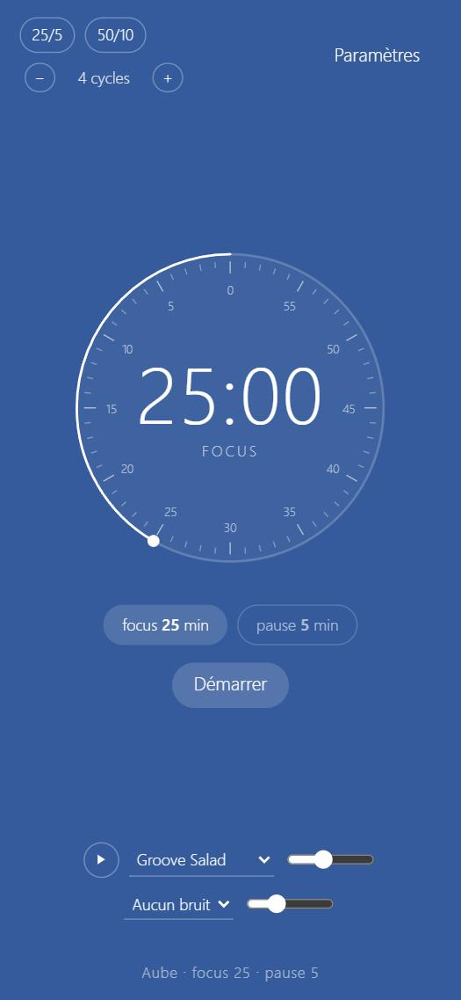
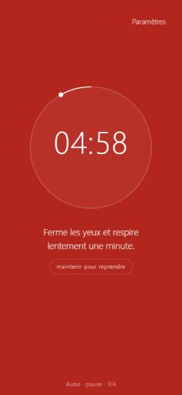

# projetfocus

Un minuteur pour rythmer tes journées de travail : un temps de focus, puis une vraie pause.
Un seul écran : la couleur de fond suit l'heure, un cadran qu'on fait tourner comme un
minuteur de cuisine, le temps restant au centre. Radio et bruits de fond en option.




La référence complète est dans [CAHIER_DES_CHARGES.md](CAHIER_DES_CHARGES.md).

---

## Utilisation en 30 secondes

1. **Tourne le cadran** (doigt ou souris) pour choisir la durée du focus. Touche « pause »
   sous le cadran pour régler la pause de la même façon. Les raccourcis 25/5 et 50/10, et le
   nombre de cycles, sont en haut à gauche.
2. **Démarrer** : le minuteur, ta musique et ton bruit de fond se lancent. **Arrêter** coupe
   tout (minuteur, musique, bruit) en gardant tes choix pour le prochain Démarrer.
   Le bouton ▶ à côté du bruit de fond (le même que pour la musique) le coupe ou le relance
   sans perdre le bruit choisi.
   Les boutons s'effacent après quelques secondes ; touche l'écran ou bouge la souris pour
   les faire revenir.
3. À la fin du focus, l'écran prend **une couleur tirée au hasard et respire doucement**, avec
   une action à faire. Ta musique du focus se met en pause et le lecteur passe sur la
   **musique de la pause** : par défaut une musique douce générée par l'appli (façon ascenseur),
   ou ce que tu choisis dans le menu du lecteur pendant la pause (même musique plus bas,
   silence, une playlist ou une radio) ; ce choix est retenu pour les pauses suivantes.
   Le curseur à côté de ce menu règle son volume. Pour reprendre avant la fin,
   **maintiens** le bouton 3 secondes ; « Arrêter » (au toucher) met fin à la série.
4. Dans les 10 dernières secondes de la pause, un « tic-tac » toutes les 2 secondes, puis
   chaque seconde (ou un « ding », au choix) (réglable, et possible aussi pour le focus dans Paramètres → Temps).
   À la fin de la pause : **3 « ding »**, puis le focus repart tout seul après 5 secondes, et ta
   musique reprend là où elle s'était arrêtée. « Fait, je reprends » permet de ne pas attendre.

L'appli se souvient de tout, même si tu fermes ou recharges la page : la phase et le temps
restant, la couleur de la pause, la musique choisie (avec le morceau et la seconde exacte de la
playlist) et le bruit de fond. Le navigateur exige un geste pour lancer du son : après un
rechargement, la musique repart au premier toucher. Choisir une musique dans le menu la lance
tout de suite.

Tout se règle dans **Paramètres** (en haut à droite, visible quand les contrôles apparaissent). Les réglages sont rangés en 8 sections repliables (Temps, Pause, Volumes et sons, Musiques, Messages, Couleurs, Affichage, Sauvegarde) : une seule s'ouvre à la fois.
Dans Paramètres → Musiques → « Musiques du menu », décoche les radios et playlists qui ne te
plaisent pas : elles disparaissent du lecteur (tu peux les recocher quand tu veux).
Les réglages restent sur l'appareil. Pour avoir les mêmes ailleurs : Paramètres → Exporter,
puis Importer sur l'autre appareil.

Raccourcis clavier : `Espace` démarre ou met en pause le focus, les flèches règlent le cadran
quand il a le focus, `Échap` ferme les Paramètres.

---

## Comment vérifier (sur ton PC, en local)

Il faut seulement Python (déjà installé chez toi).

1. Ouvre un terminal dans `C:\projetfocus` et lance :

   ```bash
   python -m http.server 8417 --bind 127.0.0.1
   ```

2. Ouvre http://localhost:8417 dans Chrome ou Edge.
3. Vérifie, dans l'ordre :
   - Le fond a une couleur qui correspond au moment de la journée (le nom est écrit en bas).
     Paramètres → Couleurs → « Voir la journée en accéléré » fait défiler les 24 h en 30 s.
   - Tourne le cadran : les graduations apparaissent, le temps change minute par minute.
   - Règle un focus de **1 minute** et une pause de **1 minute**, puis Démarrer.
   - Après 1 minute : petit son, fond coloré qui respire, une action du coach, et si une
     musique jouait, elle laisse place à la musique douce.
   - À la fin de la pause : 3 « ding », « reprise dans 5 s », puis le focus repart et ta
     musique reprend au même endroit.
   - Maintiens « maintenir pour reprendre » : un appui court ne fait rien, 3 secondes relancent
     le focus (en bas : « focus · 2/4 »).
   - Ouvre Paramètres, change une couleur ou la pulsation : l'effet est immédiat.
   - Essaie les bruits de fond : pluie, orage lointain (un grondement de temps en temps),
     vent, neige, café.
   - Lance la musique (bouton ▶ en bas) : « Playlist lofi » joue un morceau, le titre
     s'affiche avec « suivant ». Essaie aussi une radio, par exemple « Radio I♥Chillhop ».
4. Pour voir la version téléphone sur le PC : touche `F12`, puis l'icône téléphone.

`Ctrl+C` dans le terminal arrête le serveur.

> Astuce : l'appli se met en cache pour marcher hors ligne. Après une modification du code,
> recharge la page deux fois pour voir la nouvelle version.

---

## Publier sur GitHub Pages (une seule fois)

Rien n'a été envoyé sur GitHub : c'est à toi de le faire, quand tu veux.

1. Sur https://github.com/new, crée un dépôt nommé **`projetfocus`** sur ton compte perso.
   Laisse-le **public** (GitHub Pages gratuit ne publie que les dépôts publics) et ne coche
   rien (pas de README, pas de licence).
2. Dans un terminal, dans `C:\projetfocus` (remplace `TON-COMPTE`) :

   ```bash
   git remote add origin https://github.com/TON-COMPTE/projetfocus.git
   ```

   ```bash
   git push -u origin main
   ```

3. Sur GitHub, dans le dépôt : **Settings → Pages**. Sous « Build and deployment », choisis
   **Deploy from a branch**, branche **main**, dossier **/ (root)**, puis **Save**.
4. Une à deux minutes plus tard, l'appli est en ligne à
   `https://TON-COMPTE.github.io/projetfocus/`.

Pour publier une modification ensuite : `git add -A`, `git commit -m "…"`, `git push`.
Les appareils qui ont déjà l'appli prennent la nouvelle version au deuxième lancement.

À savoir : tout le contenu du dépôt devient public, y compris le cahier des charges.

---

## Installer l'appli

Une fois publiée, ouvre `https://TON-COMPTE.github.io/projetfocus/` puis :

- **PC (Chrome ou Edge)** : l'icône « Installer » dans la barre d'adresse (un écran avec une
  flèche), ou menu `⋮` → *Caster, enregistrer et partager* → *Installer projetfocus*
  (Edge : `…` → *Applications* → *Installer ce site en tant qu'application*).
  L'appli s'ouvre dans sa propre fenêtre et apparaît dans le menu Démarrer.
- **Téléphone ou tablette Android (Chrome)** : menu `⋮` → *Ajouter à l'écran d'accueil*
  → *Installer*.
- **iPhone ou iPad (Safari)** : bouton Partager → *Sur l'écran d'accueil*.

Ouvre l'appli une fois avec Internet : ensuite elle marche **hors ligne** (sauf les radios ; pour la musique embarquée, voir Paramètres → Musiques → Bibliothèque hors ligne).

Au premier démarrage d'un focus, le navigateur demande l'autorisation d'afficher des
**notifications** : accepte-la si tu veux être prévenu quand la fenêtre est cachée.

---

## Synchroniser avec Google Drive (mêmes réglages partout)

Chaque navigateur, chaque appareil et chaque adresse (`localhost`, `github.io`…) garde ses
propres réglages. Pour les avoir partout, l'appli peut les enregistrer dans un fichier
**« projetfocus-parametres.json »** de ton Google Drive (visible dans « Mon Drive »).

- À l'ouverture de l'appli (premier toucher), elle lit ce fichier ; à chaque réglage changé,
  elle le réécrit quelques secondes après. Si deux appareils ont changé quelque chose,
  **la version la plus récente gagne**.
- L'appli n'a accès qu'aux fichiers qu'elle a créés elle-même dans ton Drive, rien d'autre.
- Ne sont pas synchronisés : la musique gardée hors ligne et la phase en cours (chaque
  appareil a son propre minuteur).

### Une seule fois : créer l'identifiant de l'appli chez Google (environ 10 minutes)

Google exige que toute appli qui se connecte au Drive ait un « ID client », créé par son
propriétaire, donc toi. C'est gratuit.

1. Ouvre https://console.cloud.google.com et connecte-toi avec ton compte Google.
2. En haut, le sélecteur de projet → **Nouveau projet** → nom `projetfocus` → **Créer**,
   puis sélectionne ce projet.
3. Menu ☰ → **API et services** → **Bibliothèque** → cherche **Google Drive API** →
   **Activer**.
4. Menu ☰ → **API et services** → **Écran de consentement OAuth** (ou « Google Auth
   Platform ») → **Commencer** :
   - nom de l'appli : `projetfocus`, e-mail d'assistance : ton adresse ;
   - audience : **Externe** ;
   - coordonnées : ton adresse ; accepte les conditions → **Créer**.
5. Rubrique **Audience** → **Utilisateurs test** → **Ajouter des utilisateurs** → ton
   adresse Gmail → **Enregistrer**. Laisse l'appli « En test » : pas besoin de validation
   par Google, et toi seul peux t'y connecter.
6. Rubrique **Clients** (ou « Identifiants ») → **Créer un client** (« ID client OAuth ») :
   - type : **Application Web**, nom : `projetfocus` ;
   - **Origines JavaScript autorisées** → ajoute `http://localhost:8417` et, quand l'appli
     sera publiée, `https://TON-COMPTE.github.io` (sans `/projetfocus` à la fin) ;
   - **Créer**, puis copie l'**ID client** (il se termine par `.apps.googleusercontent.com`).
     Cet identifiant n'est pas un secret.

### Sur chaque appareil

1. Paramètres → **Sauvegarde** → colle l'ID client → **Se connecter à Google Drive**.
2. Choisis ton compte. Google affiche « Google n'a pas validé cette application » (normal,
   c'est ton appli en test) → **Continuer** → coche l'accès aux fichiers → **Continuer**.
3. La ligne d'état indique « Synchronisé à … ».

Astuce : donne-moi l'ID client et je le mets directement dans le code ; il n'y aura plus
rien à coller, seulement « Se connecter ».

Bon à savoir :
- Google renouvelle la connexion environ toutes les heures : au premier toucher, une petite
  fenêtre Google peut s'ouvrir et se refermer toute seule.
- Tant que l'appli est « en test », Google peut redemander ton accord de temps en temps
  (environ une fois par semaine).
- Sans Internet, l'appli marche normalement et synchronise au retour de la connexion.
- « Se déconnecter » arrête la synchronisation ; le fichier reste dans ton Drive.

---

## Ce qui est fait, et les écarts avec le cahier des charges

Fait : écran unique minimal, couleur sur 24 h (6 moments réglables), cadran à tourner
(1 à 60 min) qui se vide dans le sens des aiguilles d'une montre, préréglages 25/5 et 50/10,
cycles et pause longue, messages bienveillants (40 au départ, selon le moment, fréquence et
catégories réglables, liste modifiable), pause colorée qui respire, une action du coach à la
fois, maintenir pour reprendre, son, notification, plein écran, musique baissée en pause,
bruits de fond générés (pluie, orage lointain, vent, neige, café), musique douce de pause
générée, reprise automatique avec 3 « ding », mémoire de tout l'état, liens personnels, contrôles
qui s'effacent, Paramètres complets avec valeurs par défaut, export / import JSON,
enregistrement sur l'appareil, hors ligne, écran gardé allumé pendant une série.
Une série en cours survit à un rechargement de la page.

Écarts et limites :

- **Radios SomaFM** : SomaFM refuse ses flux quand ils sont lus depuis un autre site
  (testé depuis `localhost` comme depuis une adresse `github.io`). L'appli ne contourne pas
  ce blocage : les trois stations SomaFM (marquées ↗) ouvrent leur page dans un onglet.
  À la place, l'appli lit **I♥Chillhop**, **Lofi (laut.fm)**, **Nightride Chillsynth** et
  **Radio Paradise Mellow**. Ce sont des radios externes : elles peuvent changer d'adresse,
  et I♥Chillhop peut glisser un jingle. **laut.fm passe de la publicité** : ses trois radios
  (lofi, minimal, ambient) sont décochées au départ ; Paramètres → Musiques → Musiques du menu
  permet de les réactiver.
- **Bibliothèque embarquée** : deux playlists de HoliznaCC0, dans le domaine public (licence
  vérifiée sur chaque page : voir [CREDITS.md](CREDITS.md)) : « Playlist lofi » (9 morceaux, 56 Mo,
  la musique par défaut) et « Playlist ambient électro » (7 morceaux, 51 Mo), en ordre aléatoire.
  Ce sont les MP3 d'origine (320 kbit/s), donc lourds : l'appli ne les télécharge pas d'office.
  Chaque morceau écouté reste sur l'appareil ; Paramètres → Musiques → Bibliothèque hors ligne permet de
  télécharger ou de retirer une playlist entière.
- **Style « Work with Paul »** (techno, house, ambient, sans paroles) : trois radios de ce
  style sont ajoutées, testées depuis un autre site : Minimal (laut.fm), Ambient Sleeping
  Pill et Ambient Radio (laut.fm). Puis, trouvées dans l'annuaire radio-browser.info et testées :
  FIP Electro, Intergalactic FM (techno, et Dream Machine plus planante), NTS 1 et 2 (sans pub),
  Technolovers Minimal et Deep House, et deux radios Bollywood (Mirchi Top 20, Bollywood 2010s),
  décochées au départ car probablement avec pub. La house et la techno vraiment libres de droits sont rares :
  il n'y en a pas d'embarquées pour l'instant.
- **Live lofi YouTube** : pas intégré. Un lien YouTube ajouté dans « Mes liens » s'ouvre dans
  un onglet.
- **Cadran** : le style minimal (arc blanc fin) remplace le secteur violet / rouge du premier
  jet. La pause prend une couleur au hasard parmi dix (à ta demande, à la place du rouge
  fixe ; réglable dans Paramètres → Couleurs). Les couleurs du cadran et du texte
  sont réglables.
- **Coach** : une action affichée à la fois (décision de style) ; deux autres idées sont
  proposées au toucher, et on peut les choisir à la place.
- **Pulsation** : une respiration toutes les 3 s par défaut (décision de style), réglable de 1 à 8 s.
- **Plein écran** : désactivé par défaut (jugé trop brutal) ; à cocher dans Paramètres → Pause.
  Les navigateurs ne l'autorisent qu'après un geste de l'utilisateur. Si la
  pause commence sans toi, le plein écran se fait au premier toucher ou clic.
- **Fenêtre cachée** : Chrome ralentit les pages cachées ; la notification peut arriver avec
  jusqu'à une minute de retard si aucun son ne joue. Le temps affiché reste juste.
- **iPhone / iPad** : iOS ne laisse pas une page régler le volume de la radio, donc la
  baisse en pause ne s'applique qu'aux bruits de fond. Les notifications n'y marchent que
  si l'appli est installée sur l'écran d'accueil (iOS 16.4 ou plus).
- Le petit bilan du jour et la synchronisation entre appareils sont hors périmètre (version 1).

---

## Pour modifier

Aucun outil à installer : HTML, CSS et JavaScript, sans étape de build.

| Fichier | Rôle |
| --- | --- |
| `index.html` | l'écran et le panneau Paramètres |
| `css/style.css` | le style |
| `js/app.js` | minuteur, cadran, messages, coach, Paramètres |
| `js/audio.js` | radio, bruits générés, signaux sonores |
| `js/sync.js` | synchronisation des Paramètres avec Google Drive |
| `js/defaults.js` | valeurs par défaut, messages, actions du coach, radios, liste des morceaux |
| `music/` | les 9 morceaux lofi CC0 (voir CREDITS.md) |
| `sw.js` | mode hors ligne |
| `tools/make-icons.mjs` | regénère les icônes : `node tools/make-icons.mjs` |
